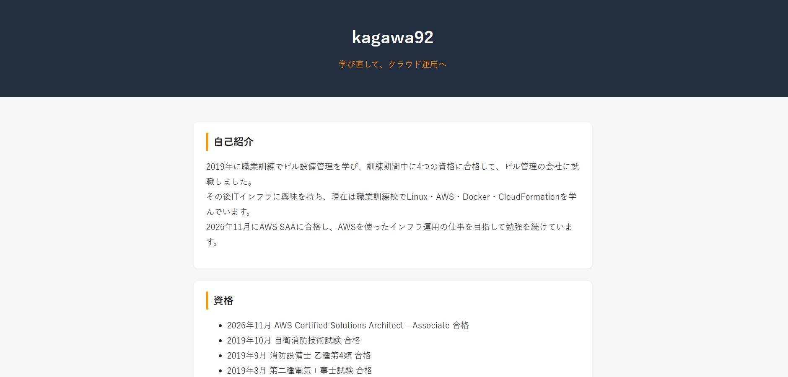
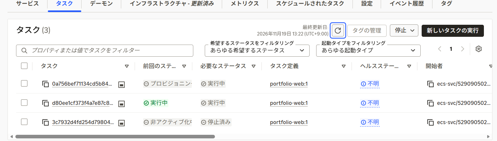
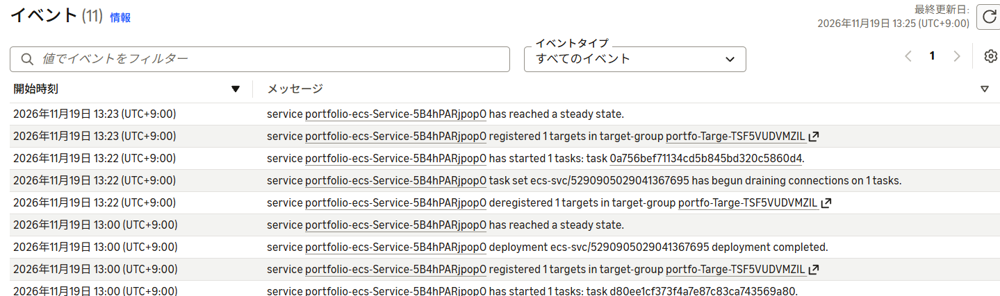
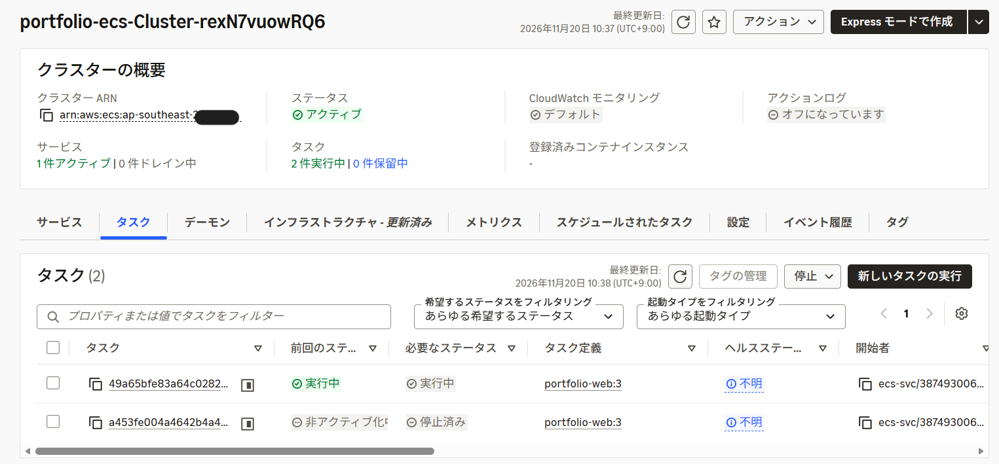
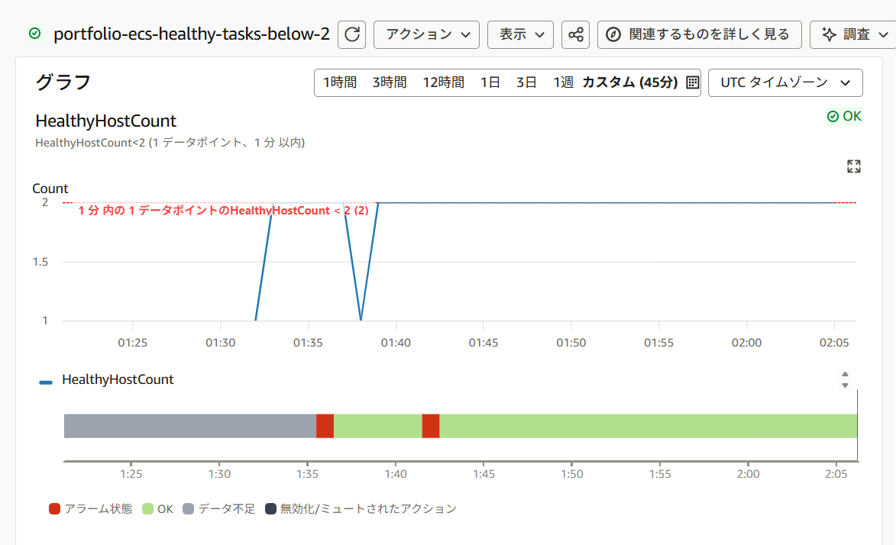
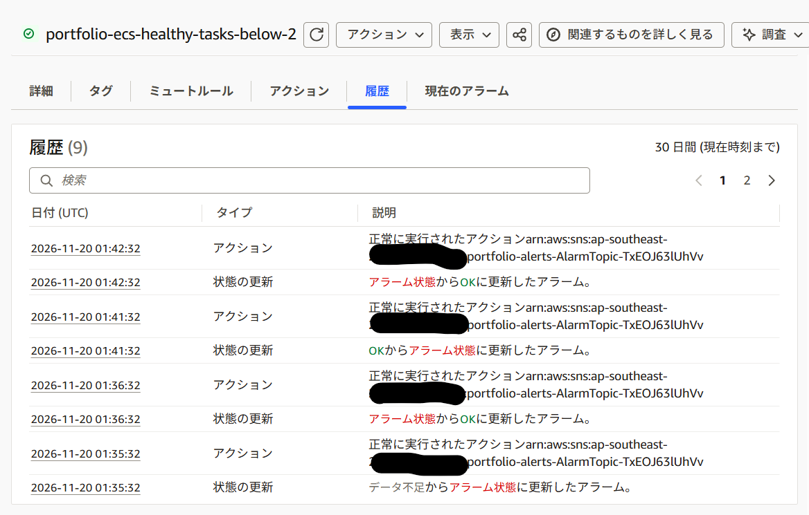
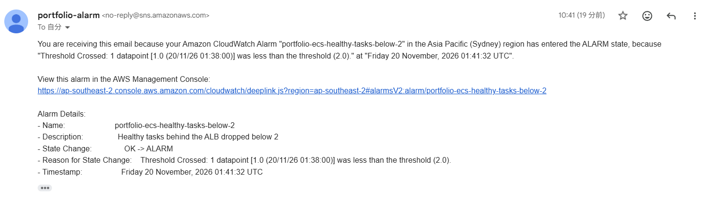
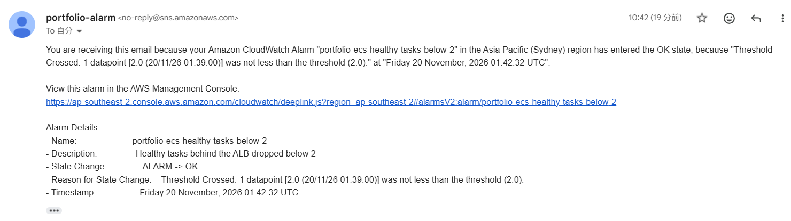
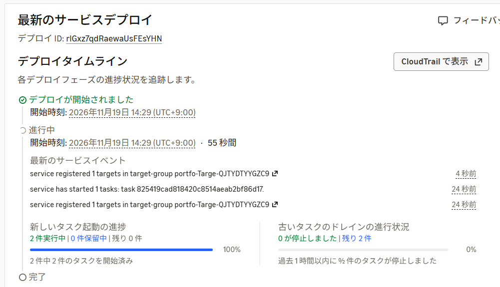
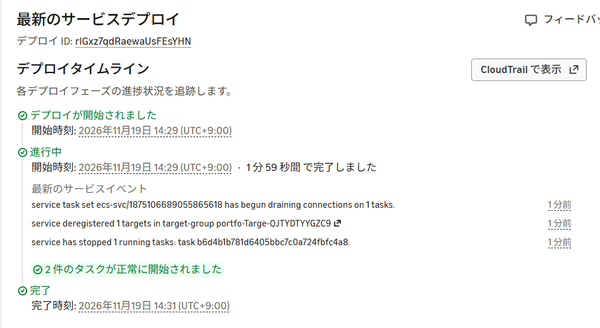

# aws-ecs-portfolio

自作のDockerイメージ(自己紹介ページ)を、ALB と ECS Fargate で公開し、CloudWatch で監視する構成を、CloudFormation で作成したポートフォリオです。

- 制作:2026年11月(職業訓練校の在籍中)
- 構成:ALB + ECS Fargate の2層構成
- 監視:CloudWatch アラームで異常を検知し、SNS でメール通知する。タスクを止めて、アラームと復旧の通知が届くことを確認した



## 構成

```
インターネット
   │
   ▼
ALB(パブリックサブネット AZ-a / AZ-b)
   │  ALB用SG:80番を全体に許可
   ▼
ECS Fargate タスク ×2(パブリックサブネット AZ-a / AZ-b に1つずつ)
   │  タスク用SG:80番を ALB の SG からだけ許可
   │
   └─ イメージは ECR(portfolio-web)から取得
      ログは CloudWatch Logs(/ecs/portfolio-web、保持7日)

監視
CloudWatch アラーム ──▶ SNS トピック ──▶ メール
 └ ALB の正常なタスクの数が2未満

プライベートサブネット AZ-a / AZ-b … 今回は使っていない(将来DBを置く場合のために用意)
```

リージョン:アジアパシフィック(シドニー)ap-southeast-2

## 使用技術

| 分類 | 内容 |
|---|---|
| AWS | VPC、ALB、ECS(Fargate)、ECR、IAM、CloudWatch(アラーム、Logs)、SNS、CloudFormation |
| コンテナ | Docker(nginx:alpine をベースに Dockerfile を作成) |
| 開発環境 | GitHub Codespaces、Git / GitHub、AWS CLI |

## ディレクトリ構成

```
.
├── app/
│   ├── Dockerfile        # nginx:alpine に index.html を入れる
│   └── index.html        # 自己紹介ページ
├── cloudformation/
│   ├── vpc.yaml          # ネットワーク(スタック名:portfolio-vpc)
│   ├── alerts.yaml       # 通知先の SNS トピック(スタック名:portfolio-alerts)
│   └── ecs.yaml          # ALB・ECS・IAMロール・ロググループ・アラーム(スタック名:portfolio-ecs)
└── docs/images/          # READMEの画像
```

## 設計で判断したこと

### 1. タスクを2つの AZ に分けた
ECS のタスクは、指定したサブネット(= 1つの AZ)で動く。サブネットを AZ-a と AZ-b の2つ指定し、タスク数を2にして、1つの AZ に障害が起きてもページが止まらないようにした。

### 2. タスクをプライベートではなく、パブリックサブネットに置いた
標準的な構成では、タスクはプライベートサブネットに置く。ただしその場合、ECR からイメージを取得したり CloudWatch Logs にログを送ったりするために、NAT ゲートウェイか VPC エンドポイントが必要になり、どちらも置いておくだけで料金がかかる。
学習用の環境なのでこの料金を避け、タスクはパブリックサブネットに置いてパブリック IP を付けた。
その代わり、タスク用のセキュリティグループは **ALB のセキュリティグループからの80番だけ**を許可し、インターネットから直接タスクにはアクセスできないようにした。
本番環境なら、プライベートサブネットに置き、NAT ゲートウェイか VPC エンドポイントを使う構成にする。

### 3. CloudFormation のスタックを、作り直す頻度で3つに分けた
- `portfolio-vpc`(VPC・サブネット・ルートテーブル・SG):置いたままでも料金がかからないので、常に残す
- `portfolio-alerts`(SNS トピックとメールの購読):置いたままでも料金がかからないので、常に残す。ECS と同じスタックにすると、作り直すたびにメールの購読確認をやり直す必要があるため分けた
- `portfolio-ecs`(ALB・ECS・アラームなど):料金がかかるので、使うときだけ作り、終わったら削除する

`portfolio-vpc` と `portfolio-alerts` の Outputs で ID や ARN を Export し、`portfolio-ecs` 側で `!ImportValue` で受け取っている。

### 4. EC2 ではなく Fargate を選んだ
職業訓練校では EC2 に Docker を入れてコンテナを動かした。ポートフォリオでは、サーバーの管理(OS の更新など)を AWS に任せられ、タスクが止まっても ECS が自動で起動し直す Fargate を選んだ。

### 5. 権限は必要なものだけにした
- タスク実行ロールには、AWS 管理ポリシー `AmazonECSTaskExecutionRolePolicy`(ECR からのイメージ取得、CloudWatch Logs への書き込み)だけを付けた
- コンテナのアプリから AWS のサービスを呼び出さないので、タスクロールは付けていない

### 6. 認証情報とアカウント ID を残さないようにした
- 長期のアクセスキーは作らず、`aws login` で一時的な認証情報を使って AWS CLI を操作した
- テンプレートでは `${AWS::AccountId}` と `${AWS::Region}` を使い、アカウント ID をファイルに書いていない

### 7. アラームは「サービスが正常に動いているか」を見るものにした
| アラーム | 見る数値 | 鳴らす条件 | 理由 |
|---|---|---|---|
| `portfolio-ecs-healthy-tasks-below-2` | ALB の `HealthyHostCount`(1分間の最小値) | 1回でも2未満 | 正常なタスクが減るのはサービスに直接関わるので、すぐ知らせる。1分間の平均ではなく最小値を見て、短い時間の減少も拾う |

- 異常になったとき(ALARM)だけでなく、**正常に戻ったとき(OK)にも通知**する。対応した人が復旧を確認できるようにするため

## 動作確認

### タスクを1つ止めて、自動で復旧するか
ECS のコンソールから、実行中のタスク2つのうち1つを手動で停止した。

| 時刻 | ECS サービスのイベント | 意味 |
|---|---|---|
| 13:22 | deregistered 1 targets in target-group | 止めたタスクを ALB の振り分け先から外した |
| 13:22 | has begun draining connections on 1 tasks | 止めたタスクへの通信を止める処理を開始 |
| 13:22 | has started 1 tasks | タスクが1つ足りないので、新しいタスクを起動 |
| 13:23 | registered 1 targets in target-group | 新しいタスクを振り分け先に登録 |
| 13:23 | has reached a steady state | タスクが2つに戻った |

約1分で元の2つに戻り、その間も、もう1つのタスクでページは表示され続けた。
今回は、ECS サービスが「必要なタスク数は2、実行中は1」という不足に気づいて、新しいタスクを起動した。




### タスクを止めて、アラームと通知が届くか
タスクを1つ手動で止め、正常なタスクの数のアラームが鳴り、復旧後に OK の通知が届くことを確認した(時刻は日本時間)。

| 時刻 | 起きたこと |
|---|---|
| 10:38 | タスクを1つ停止 → 正常なタスクの数が 2 → 1 |
| 10:39 | ECS が新しいタスクを起動し、ヘルスチェックに合格 → 2 に戻る |
| 10:41 | ALARM のメール(理由の欄:10:38 の値が 1.0) |
| 10:42 | OK のメール(理由の欄:10:39 の値が 2.0) |







分かったこと:
- **通知は、実際の変化から約3分遅れて届く**。アラームを受けた時点で、問題はすでに数分前に起きていると考える必要がある
- **スタックを作った直後にも、一度アラームが鳴った**(グラフの1つめの赤い帯)。2つめのタスクがまだ準備中だったためで、通知の理由の欄の時刻を見て、タスクを止めたことによるものではないと切り分けた。実際の運用では、デプロイ中は通知を止める、などの対策が考えられる

### スタックを削除して、作り直せるか
`portfolio-ecs` を削除してページが表示されなくなることを確認し、同じテンプレートから作り直して、同じページが表示されることを確認した。作成にかかる時間は約4分。
作り直すと ALB の DNS 名が変わるので、URL を伝えるときは作り直した後のものを使う。

### ページを止めずに更新できるか
`index.html` を直してイメージを作り直し、ECR に push したあと、ECS サービスで「新しいデプロイを強制」を実行した(タグは `latest` のままなので、強制しないとタスクが入れ替わらない)。

1. 14:29 デプロイ開始。新しいタスク2つが起動し、ターゲットグループに登録された(この時点では新旧4つのタスクが動いている)
2. 新しいタスクが正常になってから、古いタスクを登録解除し、通信を止めてから停止した
3. 14:31 完了(1分59秒)

新しいタスクが正常になってから古いタスクを止めるため、更新中もページは表示され続けた。




## コストの工夫

- NAT ゲートウェイを使わない
- 普段は `portfolio-ecs` を削除し、面接など必要なときだけ作り直す(`portfolio-vpc` は料金がかからないので残す)
- タスクの CPU・メモリは Fargate の最小構成(0.25 vCPU / 512 MB)
- ログの保持期間は7日
- アラームも `portfolio-ecs` に入れ、ECS と一緒に削除する(SNS トピックは置いておくだけなら料金がかからない)
- AWS Budgets で予算アラートを設定

## 作り方・消し方

### 作り方
1. ECR にリポジトリ `portfolio-web` を作る(コンソールで作成)
2. イメージを作って ECR に push する
   ```bash
   cd app
   docker build -t portfolio-web .
   ACCOUNT_ID=$(aws sts get-caller-identity --profile portfolio --query Account --output text)
   REPO=$ACCOUNT_ID.dkr.ecr.ap-southeast-2.amazonaws.com
   aws ecr get-login-password --region ap-southeast-2 --profile portfolio | docker login --username AWS --password-stdin $REPO
   docker tag portfolio-web:latest $REPO/portfolio-web:latest
   docker push $REPO/portfolio-web:latest
   ```
3. `cloudformation/vpc.yaml` からスタック `portfolio-vpc` を作る
4. `cloudformation/alerts.yaml` からスタック `portfolio-alerts` を作る(パラメータ `NotificationEmail` に通知を受けるメールアドレスを入力)。届いた確認メールの「Confirm subscription」を押す
5. `cloudformation/ecs.yaml` からスタック `portfolio-ecs` を作る(「IAM リソースの作成を承認」にチェック)
6. `portfolio-ecs` の出力 `AlbUrl` をブラウザで開く

### 消し方
1. `portfolio-ecs` を削除する
2. (すべて消す場合)`portfolio-alerts` と `portfolio-vpc` を削除する。`portfolio-ecs` が Export を使っている間は削除できないので、必ず `portfolio-ecs` を先に消す
3. (すべて消す場合)ECR のリポジトリを削除する

## つまずいたこと

- **AWS CLI のログイン**:Builder ID でサインインするアカウントで `aws login` を実行したところ、IAM ユーザーのサインイン画面が表示された。先にブラウザでコンソールを開いておき、そのセッションを選ぶことでログインできた。Codespaces では `aws login --remote` を使った
- **push が拒否された**:GitHub のブラウザ画面からアップロードしたファイルと、Codespaces で commit したファイルが重なり、`git push` が拒否された。`git pull --rebase` で GitHub 側の変更を取り込んでから解決した

## 今後やること

- CPU 使用率など、性能の低下に気づくためのアラームを追加する
- デプロイ中に通知が出ないようにする
- イメージのタグを `latest` の使い回しから、バージョンごとのタグに変え、どのイメージが動いているか追えるようにする
- GitHub Actions で、テンプレートのチェック(cfn-lint)とイメージの push を自動化する
- HTTPS 化(ACM の証明書と443番のリスナー)
